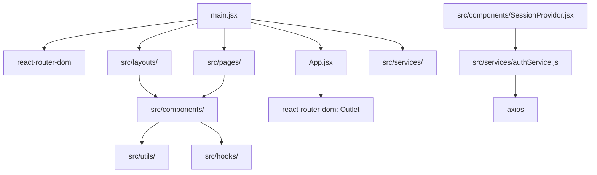

# Project Architecture - Metaskills Frontend

This document outlines the high-level architecture, dependency graph, and data flow of the Metaskills frontend application.

## 1. Core Structure & Entry Point

- **Entry Point:** `src/main.jsx`
  - Responsibilities: Application bootstrapping, Router initialization (`react-router-dom`), Provider wrapping (`HelmetProvider`, `GlobalStyle`, `GoogleOAuthProvider`, `SessionProvidor`).
- **Main Layout Wrapper:** `src/App.jsx`
  - Responsibilities: Main application container, Toast notifications provider.

## 2. File Dependency Graph

## 3. Data Flow

1. **Authentication:**

   - `GoogleOAuthProvider` (External) -> `SessionProvidor` -> Shared Auth State.
   - `services/authService.js` communicates with backend API (base URL from `VITE_BACKEND_API`).

2. **Routing & Layouts:**

   - Routes are defined in `main.jsx`.
   - `ProtectedRoute` / `ProtectedAdminRoute` gate-keep access based on session state.
   - `layouts/` wrap components to provide consistent UI (e.g., Nav bars, Footers).

3. **Module State:**
   - `context/ModuleContext.jsx` provides `module` and `setModule` to components via `useModule` hook.

## 4. Component Interconnectivity

Metaskills utilizes a logical chain for question processing and rendering:

### Question Authoring (Admin)

`AddQuestions.jsx` -> `questionValidation.js` -> `EditorContext.jsx` -> `authService.js` (persistence)

### Question Rendering (Consumer)

`QuizPanel.jsx` / `MathMarathonQuiz.jsx` -> `SlateRenderer.jsx` (Core) / `MathQuestion.jsx` (Marathon) -> `slateUtils.js` (Normalization)

### Answer Validation

`Marathon` renderers -> `answerValidation.js` -> `QuizResultDisplay.jsx` (Feedback)

## 5. Critical Files

- [main.jsx](file:///home/jimfleax/Projects/metaskills/src/main.jsx): Router configuration and provider nesting.
- [SessionProvidor.jsx](file:///home/jimfleax/Projects/metaskills/src/components/SessionProvidor.jsx): Global lifecycle and auth synchronization.
- [SlateRenderer.jsx](file:///home/jimfleax/Projects/metaskills/src/components/SlateRenderer.jsx): Primary engine for rich-text and formula rendering.
- [authService.js](file:///home/jimfleax/Projects/metaskills/src/services/authService.js): Central interface for backend interaction.
- [answerValidation.js](file:///home/jimfleax/Projects/metaskills/src/utils/answerValidation.js): Grade-agnostic evaluation engine.
