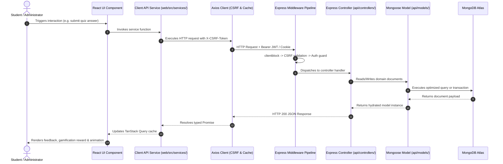

# Architecture Overview: MetaSkills Platform

## 1. System Purpose
MetaSkills is an adaptive, gamified assessment and learning platform engineered for students. The platform delivers personalized curricula, interactive reading comprehension modules, automated vocabulary spaced repetition (SRS), and real-time mathematical reasoning drills supported by generative AI feedback.

---

## 2. Technology Stack

### Backend (`api/`)
- **Runtime & Framework:** Node.js (ES Modules), Express `^5.1.0`
- **Database & ODM:** MongoDB Atlas via Mongoose `^8.16.1`
- **Authentication & Security:** JWT (`jsonwebtoken`), Google OAuth (`google-auth-library`), Bcrypt, CSRF token validation, Origin-based CORS guards
- **AI & Numerical Engine:** Google GenAI SDK (`@google/genai`), OpenAI SDK, Algebrite CAS, Mathjs, Compromise NLP
- **Storage & Infrastructure:** Google Cloud Storage (`@google-cloud/storage`), Brevo (`@getbrevo/brevo`), Vercel Serverless Functions

### Frontend (`web/`)
- **Build & Framework:** Vite `^6.3.5`, React `^18.3.1`, React Router `^7.6.1`
- **State & Server Cache:** TanStack Query `^5.90.21`, React Context API
- **Styling & UI Primitives:** styled-components `^6.1.19`, Radix UI primitives, Framer Motion `^12.30.0`
- **Rich Text & Math:** Slate.js (`slate`, `slate-react`), Mathlive `^0.105.3`, KaTeX, Rehype/Remark Math
- **Monitoring & Utilities:** Vercel Analytics, Tesseract.js OCR, Chart.js

### Monorepo Tooling
- **Package Manager:** pnpm workspaces (`packageManager: pnpm@12.18.0`)
- **Quality Gates:** ESLint 9 (flat config), Jest 30 with ESM flags, Supertest, Fast-check

---

## 3. Architecture Pattern

The system employs a client-server monorepo architecture designed for unified development and seamless serverless hosting on Vercel:

```
┌────────────────────────────────────────────────────────┐
│                   Vercel Edge / CDN                    │
└───────────────┬────────────────────────┬───────────────┘
                │                        │
       /api/*   │                        │   /* (Static SPA)
                ▼                        ▼
┌────────────────────────┐      ┌────────────────────────┐
│   Express Backend API  │      │     React 18 SPA       │
│  (Vercel Serverless /  │◄─────┤ (Vite, TanStack Query, │
│    Node server.js)     │      │   Styled-Components)   │
└───────────┬────────────┘      └────────────────────────┘
            │
            ├──────────────────────────┬──────────────────────────┐
            ▼                          ▼                          ▼
┌───────────────────────┐  ┌───────────────────────┐  ┌───────────────────────┐
│     MongoDB Atlas     │  │  Google Cloud Storage │  │ External AI Providers │
│ (Mongoose ODM Models) │  │  (Media & Attachments)│  │ (Gemini, Groq, NVIDIA)│
└───────────────────────┘  └───────────────────────┘  └───────────────────────┘
```

---

## 4. Layer Map & Data Flow



---

## 5. Key Design Decisions

### 5.1 Dual-Token Authentication & Granular Access Control
- **Student Authentication:** Employs Google OAuth tokens exchanged for server-signed JWTs stored in HTTP-only cookies (`api/controllers/user.controller.js`).
- **Admin Authentication:** Segregated credential path with dedicated bcrypt password hashing, token validation, and separate middleware protection (`api/middlewares/adminAuth.js`).
- **Guarded Routing:** Frontend enforces route separation through `<AuthGuard>` and `<ProtectedAdminRoute>`, preventing privilege escalation.

### 5.2 Serverless Cold Start & Database Connection Pool Management
- File: `api/config/database.js`
- Express handlers reuse a cached Mongoose connection pool rather than opening fresh connections on each serverless invocation.
- Readiness probes (`/api/healthz/ready`) check connection state and fail early if the replica set is unreachable.

### 5.3 Anti-Tamper Gamification Engine
- File: `api/controllers/user.controller.js`, `api/models/user.model.js`
- User rewards ("carrots") and streaks are calculated and validated server-side on question completion.
- Idempotency mechanisms (`api/models/Idempotency.model.js`) prevent duplicate reward claims or multiple submissions for the same quiz attempt.

### 5.4 Leitner 5-Box Spaced Repetition System (SRS)
- File: `api/controllers/vocabulary.controller.js`, `api/models/VocabProgress.model.js`
- Tracks student vocabulary mastery across intervals (Boxes 1 to 5).
- Correct answers advance words to longer intervals; incorrect answers demote words back to Box 1, ensuring adaptive reinforcement.

### 5.5 Rich Mathematical & Linguistic Expression
- Frontend leverages Slate JSON AST structures alongside Mathlive and KaTeX for LaTeX mathematical expressions (`web/src/components/Latex.jsx`, `web/src/components/Marathon/Inputs/MathInput.jsx`).
- Backend uses Algebrite and Mathjs (`api/services/math.service.js`) for computer algebra validation, ensuring mathematically equivalent expressions are graded accurately.

---

## 6. Cross-Cutting Concerns

| Concern | Implementation Location | Strategy |
|---|---|---|
| **CORS & Origin Filtering** | `api/middlewares/clientblock.js` | Enforces whitelist matching against configured origins (`CORS_ORIGIN`). Attaches CORS headers uniformly, including on 4xx/5xx responses. |
| **CSRF Defense** | `api/middlewares/csrfMiddleware.js` | Cryptographically generated CSRF tokens served via `/api/csrf-token` and verified on mutating methods (`POST`, `PUT`, `DELETE`). |
| **Centralized Error Handling** | `api/middlewares/errorHandler.js` | Intercepts unhandled errors, formats structured JSON payloads, and masks stack traces in production. |
| **Error Telemetry** | `api/controllers/error.controller.js`, `web/src/components/common/ReportErrorModal.jsx` | User error reports and runtime exceptions are persisted in `api/models/Errors.model.js` with device metadata. |
| **Client Caching & Mutex** | `web/src/services/api.js` | In-memory cache for high-frequency GET requests with automated cache eviction on mutations. |

---

## 7. External Integrations

- **Google Cloud Identity:** Google OAuth 2.0 client verification for SSO (`google-auth-library`).
- **Google Cloud Storage:** Asset uploads for reading passages, audio pronunciation files, and error report screenshots (`@google-cloud/storage`).
- **Generative AI Providers:** Multi-provider fallback supporting Google Gemini (`@google/genai`), Groq, and NVIDIA NIM for explanation synthesis and dynamic question variation.
- **Brevo:** Transactional SMTP email delivery for notifications and account verifications (`@getbrevo/brevo`).
