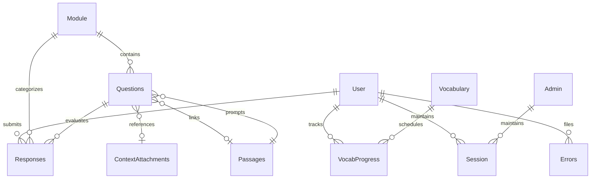

# Backend API and Data Models: Mongoose Schemas

This document defines the data models, validation constraints, compound indexes, hooks, and entity relationships across the MongoDB database backing MetaSkills.

---

## 1. Entity Relationship Diagram

---

## 2. Core Model Schemas

### 2.1 `User`
- **File:** `api/models/user.model.js`
- **Collection:** `users`
- **Description:** Student user profile entity tracking gamification currency, Elo proficiency, streaks, and grade preferences.
- **Fields:**
  - `fullname` (String, required, trimmed): Student display name.
  - `email` (String, required, unique, lowercase, trimmed): Student email verified via OAuth.
  - `profilePicture` (String, default `""`): Public avatar URL.
  - `grade` (Number, optional, enum: `[1..12]`): Academic grade level.
  - `lastSeen` (Number, default `Date.now`): Timestamp of latest user heartbeat.
  - `week` (Number, default `1`): Current curriculum week tracker.
  - `days` (Array<Number>, default `[-1, -1, -1, -1, -1, -1, -1]`): 7-day attendance bitmask/state.
  - `carrots` (Subdocument):
    - `count` (Number, default `0`, min `0`): Current spendable gamification carrots.
    - `lastdate` (Date, default `Date.now`): Date of latest carrot transaction.
    - `history` (Array<Number>, default `[0, 0, 0, 0, 0, 0, 0]`): Weekly carrot acquisition tally.
  - `elo` (Number, default `1200`): Dynamic skill rating for adaptive matchmaking.
  - `active` (Boolean, default `true`): Soft account activation flag.
- **Indexes:**
  - `{ email: 1 }` (unique)
- **Relationships:** Referenced by `Responses.userId`, `VocabProgress.user`, `Errors.user`, `Session.userId`.

---

### 2.2 `Admin`
- **File:** `api/models/admin.model.js`
- **Collection:** `admins`
- **Description:** Privileged administrative accounts permitted to curate content, inspect active sessions, trigger backups, and run migrations.
- **Fields:**
  - `fullname` (String, required, trimmed): Administrator name.
  - `email` (String, required, unique, lowercase, trimmed): Google OAuth email address.
  - `role` (String, enum: `["admin", "superadmin"]`, default `"admin"`): Access tier.
- **Indexes:**
  - `{ email: 1 }` (unique)
- **Relationships:** Referenced by `Session.userId` when `onModel: "Admin"`.

---

### 2.3 `Module`
- **File:** `api/models/Module.model.js`
- **Collection:** `modules`
- **Description:** Subject curriculum units grouping questions by pedagogical topics and target grades.
- **Fields:**
  - `name` (String, required): Module title (e.g. "Linear Equations").
  - `subject` (String, enum: `["english", "maths"]`, required): Primary curriculum discipline.
  - `questionIds` (Array<ObjectId>, ref: `"Question"`, default `[]`): Ordered array of contained question references.
  - `grades` (Array<Number>, default `[]`): Applicable school grades (validated `1 <= grade <= 12`).
  - `isComplete` (Boolean, default `false`): Curriculum publication readiness flag.
- **Indexes:**
  - `{ subject: 1, name: 1 }` (compound, unique): Guarantees unique module titles within each subject.
- **Hooks:**
  - `pre("validate")`: Automatically deduplicates elements in `questionIds`.
- **Relationships:** Parent of `Questions.model.js`; referenced by `Responses.moduleId`.

---

### 2.4 `Questions`
- **File:** `api/models/Questions.model.js`
- **Collection:** `questions`
- **Description:** Polymorphic assessment questions supporting Multiple Choice (MCQ), Short Answer (SA), and Fill in the Blanks.
- **Fields:**
  - `question.slate` (Mixed, required): Rich text question stem stored as Slate.js AST.
  - `answerType` (String, enum: `["SA", "MCQ", "fillInTheBlanks"]`, required): Interaction format.
  - `options` (Subdocument):
    - `sa` (String, default `""`): Canonical answer string / LaTeX formula for short-answer questions.
    - `fillInTheBlanks` (Array<String>, default `[]`): Expected token strings for sentence gap fills.
    - `mcq` (Array<Subdocument>): Four rich text options with auto-generated ObjectIds.
  - `correctOption` (ObjectId, conditional required): ObjectId referencing the winning option in `options.mcq`.
  - `explanation.slate` (Mixed): Rich text pedagogical explanation shown after answer submission.
  - `skills` (Array<String>, default `[]`): Pedagogical skill taxonomy tags (e.g. "algebra-quadratics").
  - `difficulty` (Number, default `1200`): Elo difficulty rating of the question item.
  - `modules` (Array<ObjectId>, ref: `"Module"`, default `[]`): Modules containing this question.
  - `contextAttachment` (ObjectId, ref: `"ContextAttachment"`, optional): Linked media/reading asset.
  - `passageId` (ObjectId, ref: `"Passages"`, optional): Parent reading passage for comprehension questions.
  - `isTrash` (Boolean, default `false`): Soft delete flag.
- **Indexes:**
  - `{ isTrash: 1, modules: 1 }`: Accelerated question bank filtering.
  - `{ difficulty: 1 }`: Adaptive question selection.
- **Hooks:**
  - `pre("validate")`: Enforces conditional option requirements based on `answerType`.

---

### 2.5 `Responses`
- **File:** `api/models/Responses.model.js`
- **Collection:** `responses`
- **Description:** Student answer attempts capturing question outcome, time spent, and adaptive ratings.
- **Fields:**
  - `userId` (ObjectId, ref: `"User"`, required): Student submitter.
  - `isMarathon` (Boolean, default `false`): Differentiates curriculum quizzes from marathon practice.
  - `questionId` (ObjectId, ref: `"Question"`, conditional required): Target question.
  - `moduleId` (ObjectId, ref: `"Module"`, conditional required): Parent module.
  - `passageId` (ObjectId, ref: `"Passages"`, optional): Reading passage context if applicable.
  - `response` (Mixed, required for curriculum): Submitted option ID, text string, or token array.
  - `timeTaken` (Number, required): Time in seconds to complete the question.
  - `accuracy` (Number, default `0`): Normalized accuracy score (0 or 1).
  - `carrotsAwarded` (Number, default `0`): Gamification currency awarded for the attempt.
  - `createdAt` (Date, default `Date.now`): Submission timestamp.
- **Indexes:**
  - `{ userId: 1, moduleId: 1, createdAt: -1 }`: Quick retrieval of student module history.
  - `{ userId: 1, createdAt: -1 }`: Daily accuracy trend aggregations.

---

### 2.6 `Passages`
- **File:** `api/models/Passages.model.js`
- **Collection:** `passages`
- **Description:** Reading comprehension passages and benchmark sentence corpuses.
- **Fields:**
  - `title` (String, optional): Headline / Title of the reading passage.
  - `type` (String, enum: `["passage", "sentence"]`, default `"passage"`): Content classification.
  - `text` (String, required): Plain text or markdown reading corpus.
  - `rating` (Number, default `1200`): Reading difficulty Elo rating.
- **Relationships:** Referenced by `Questions.passageId` and `Responses.passageId`.

---

### 2.7 `Vocabulary` & `VocabProgress`
- **Files:** `api/models/Vocabulary.model.js`, `api/models/VocabProgress.model.js`
- **Collections:** `vocabularies`, `vocabprogresses`
- **Description:** Spaced repetition lexical items and student Leitner box memory tracking.
- **Vocabulary Fields:**
  - `word` (String, required, unique, trimmed): Target lexical word.
  - `definition` (String, required, unique, trimmed): Lexical definition.
  - `rating` (Number, default `1200`): Word difficulty rating.
- **VocabProgress Fields:**
  - `user` (ObjectId, ref: `"User"`, required): Student user reference.
  - `word` (ObjectId, ref: `"Vocabulary"`, required): Vocabulary term reference.
  - `box` (Number, default `0`): Leitner SRS box level (0 to 5).
  - `nextReviewDate` (Date, default `Date.now`): Timestamp when the word becomes due for review.
  - `lastSentenceTestedAt` (Date, default `null`): Timestamp of sentence usage review.
- **Indexes:**
  - `vocabProgressSchema.index({ user: 1, nextReviewDate: 1 })`: Review queue scheduling.
  - `vocabProgressSchema.index({ user: 1, word: 1 }, { unique: true })`: Prevents duplicate tracking per user/word.

---

### 2.8 `Idempotency`
- **File:** `api/models/Idempotency.model.js`
- **Collection:** `idempotencies`
- **Description:** Distributed operation locking and mutation replay prevention.
- **Fields:**
  - `userId` (ObjectId, required): Initiator user ID.
  - `key` (String, required): UUID passed via `X-Idempotency-Key` header.
  - `status` (String, enum: `["pending", "completed"]`, default `"pending"`): Transaction status.
  - `responseCode` (Number): HTTP status code of completed response.
  - `responseData` (Mixed): Cached response payload returned on subsequent duplicate submissions.
  - `requestHash` (String): SHA-256 payload digest preventing spoofing.
  - `createdAt` (Date, default `Date.now`, expires `"6h"`): Auto-eviction TTL index.
- **Indexes:**
  - `{ userId: 1, key: 1 }` (compound, unique): Guarantees single-flight mutations.
  - `{ createdAt: 1 }` (`expireAfterSeconds: 21600`): Automatic 6-hour purge.

---

### 2.9 `Session`
- **File:** `api/models/session.model.js`
- **Collection:** `sessions`
- **Description:** Active user session heartbeats for concurrent login moderation.
- **Fields:**
  - `userId` (ObjectId, required, refPath: `"onModel"`): User or Admin reference.
  - `onModel` (String, required, enum: `["User", "Admin"]`): Discriminator model.
  - `token` (String, required): JWT session token.
  - `ip` (String, default `""`): Client remote IP address.
  - `userAgent` (String, default `""`): Client browser string.
  - `lastActive` (Date, default `Date.now`): Latest heartbeat timestamp.
- **Indexes:**
  - `{ userId: 1, token: 1 }`: Rapid session lookup during authentication verification.

---

### 2.10 `Errors`
- **File:** `api/models/Errors.model.js`
- **Collection:** `errors`
- **Description:** Bug reports and client runtime diagnostics.
- **Fields:**
  - `user` (ObjectId, ref: `"User"`, required): Reporting student.
  - `screenshotFilename` (String, default `null`): GCS filename of captured screenshot.
  - `reportType` (String, enum: `["automatic", "manual"]`, default `"manual"`): Source.
  - `category` (String, enum: `["ui_bug", "content_error", "feature_request", "technical_issue", "other"]`): Classification.
  - `environment` (String, required): Browser runtime context.
  - `userDescription` (String, required): Student description.
  - `systemMetadata` (Subdocument): Browser version, viewport size, URL route, and stack traces.
- **Indexes:**
  - `{ createdAt: -1 }`: Sorted display in the administrative triage inbox.
